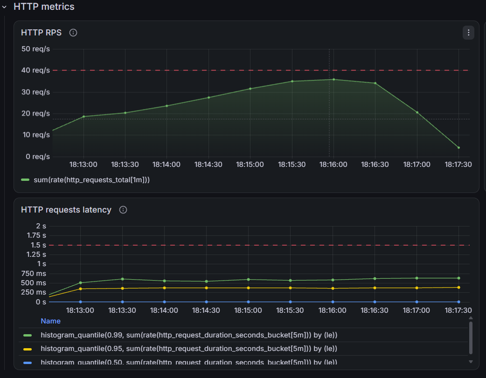
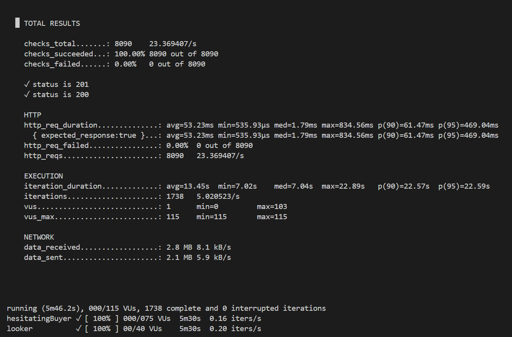
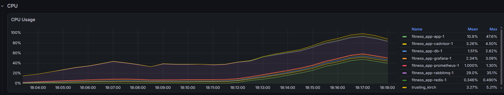
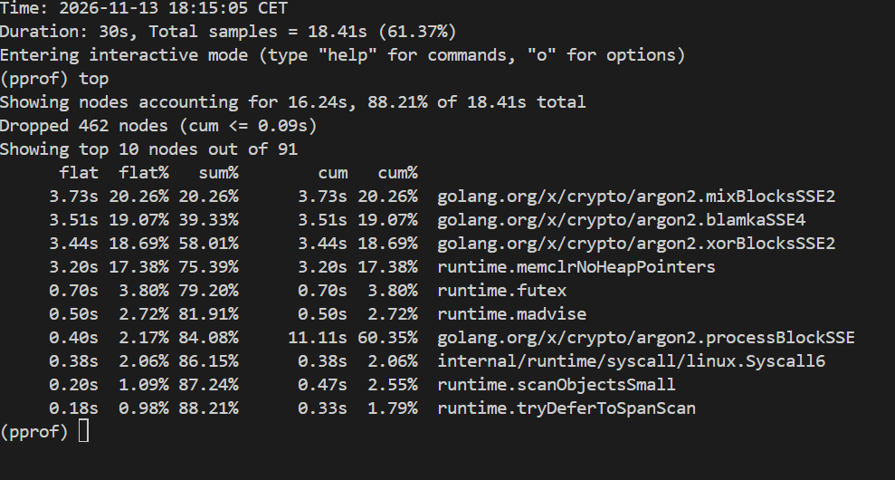

# Fitness Club App

An application for managing fitness club access with integrated payment system.

<div>

**Grafana dashboard (left) vs. k6 test results (right)**




</div>

*Increase in latency is caused by Stripe API calls.*
*Rate limiting was disabled during the test to measure actual application throughput.*

## Features

- User authentication and role-based access control
- Membership management
- Stripe subscription billing
- QR-based gym access
- Asynchronous payment events processing
- Custom middleware, including rate limiting
- Metrics and monitoring
- Customizable load testing

## Tech Stack

- Go 1.26
- PostgreSQL 16
- Redis 7
- Docker
- Stripe API
- RabbitMQ 3.13
- Prometheus 3.15
- Grafana 13.2
- K6 2.3

## Requirements

- Docker
- [Stripe CLI](https://docs.stripe.com/cli)
- Be logged into Stripe:
```bash
stripe login
```

## First start (localhost)

### 1. Clone the repository

```bash
git clone https://github.com/VialikovIvan/fitness_app.git
cd fitness_app
```
### 2. Run the setup script

Linux/Mac/Windows(Git Bash):

```bash
chmod +x setup.sh
./setup.sh
```

## Following starts

```bash
docker compose up -d
```

In a separate terminal:

```bash
stripe listen --forward-to localhost:8080/webhooks/stripe --all-snapshot
```

## Load testing

**CPU spike during test (top) vs. pprof showing Argon2 as the reason (bottom)**




*At 8 registrations/sec, CPU hit 98%. Profiling shows ~75% of that
is Argon2 password hashing — by design, not a bug.*

### 1. Change app mode in `.env`

```bash
MODE=test
```

> ⚠️ **Remember to revert this change.** Leaving `MODE=test` in production 
> allows cookies to be sent over plain HTTP, exposing auth tokens.

### 2. Run the app and wait until `docker compose ps` shows all services as `healthy`

```bash
docker compose up -d
```

### 3. Run the stress test in a separate terminal

```bash
docker run --rm -i --network=fitness_app_default grafana/k6 run - < ./loadtest/stress-test.js
```

### 4. View results

- **K6 Summary** — printed in the terminal after the test
- **Grafana** — `http://localhost:3000` → dashboards

## Ports

| Service | Port |
|---------|------|
| App | 8080 |
| Postgres | 5432 |
| Redis | 6379 |
| RabbitMQ AMQP | 5672 |
| RabbitMQ UI | 15672 |
| Prometheus | 9090 |
| Grafana | 3000 |
| pprof | 6060 |
